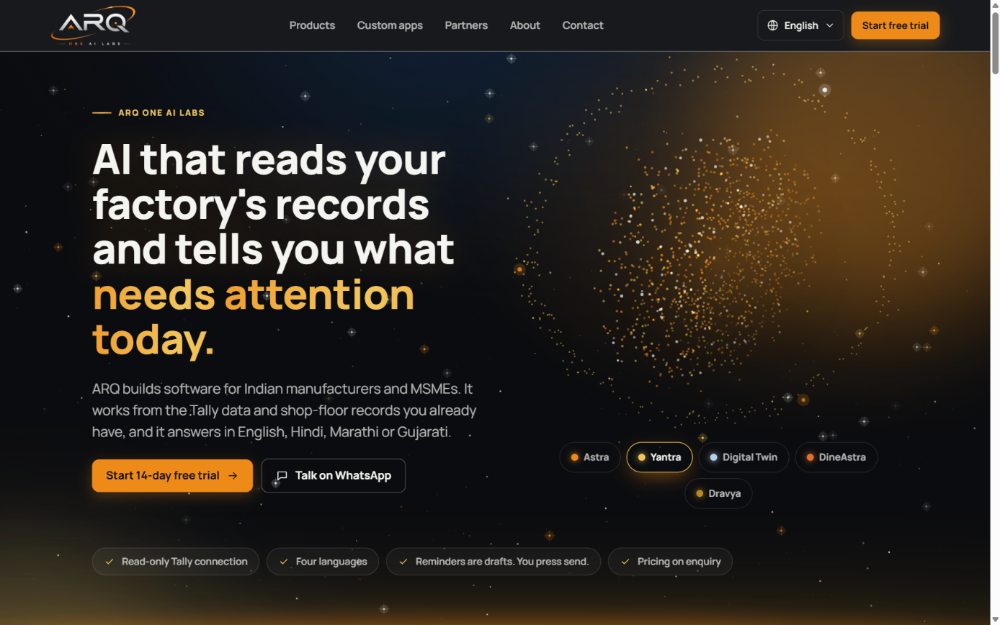
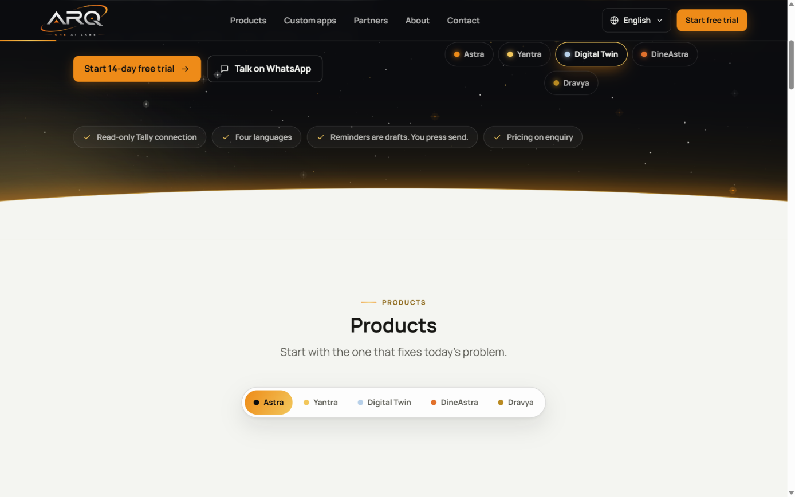
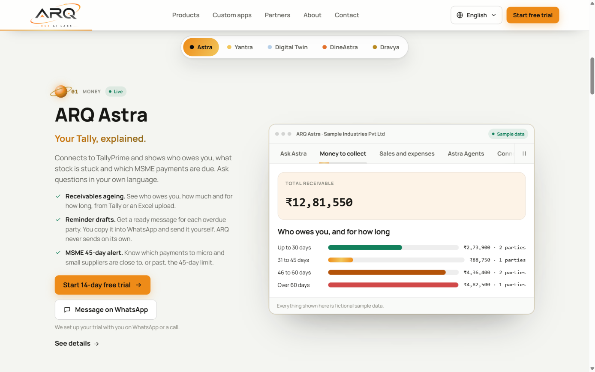
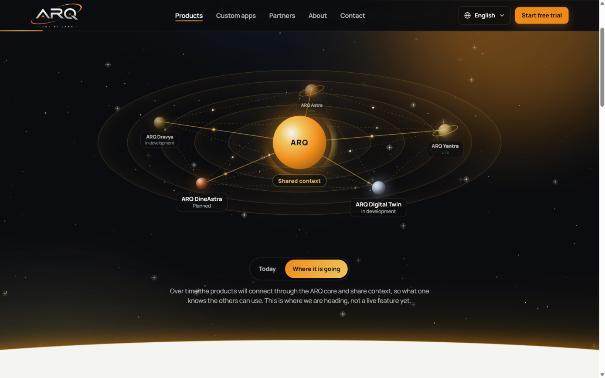
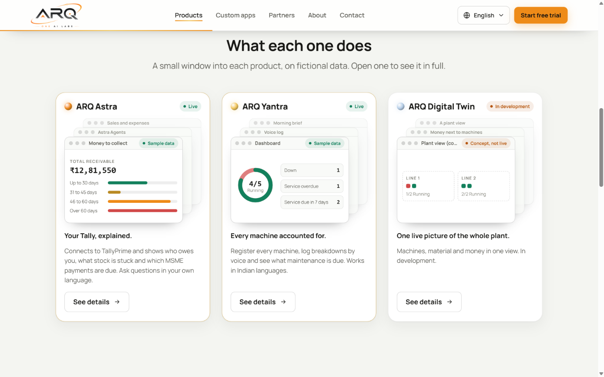
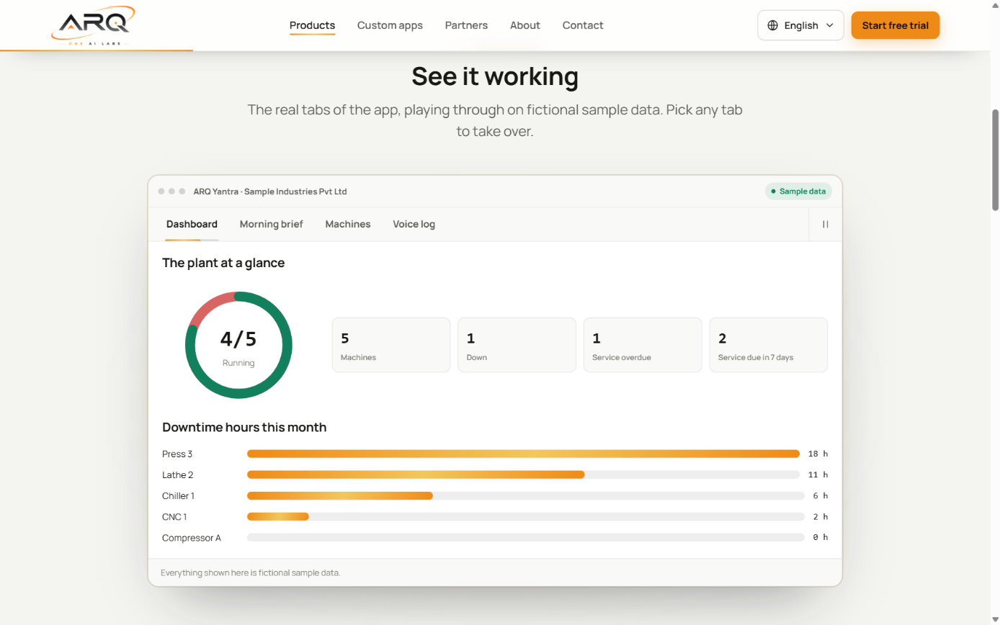

# ARQ ONE AI Labs website

The public website for [ARQ ONE AI Labs](https://arqoneailabs.space): a fast, accessible, four-language site for Indian factory and MSME owners. Orange, white and gold. Space where the animations are, daylight where the details are: the real ARQ logo, a live starfield, a particle orb that morphs into each product, a scout ship, a product solar system that shows where the products are heading, and a working demo window for every product, built from fictional sample data.

| | |
| --- | --- |
|  |  |
|  |  |
|  |  |

## Run it

You need Node.js 20 or newer and Python 3.9 or newer (the content gate is a Python script).

```bash
npm run setup     # install dependencies and run the content gate once
npm run dev       # http://localhost:3000  (redirects to /en)
```

Other commands:

| Command | What it does |
| --- | --- |
| `npm test` | Content gate, sample-data check, hex-colour check, typecheck, lint, then all unit tests |
| `npm run build` | Production build. 52 static pages plus the enquiry API |
| `npm run check:build` | After a build: one `h1`, canonical, hreflang, Open Graph, JSON-LD, official contacts only, CTAs match status |
| `npm run start` | Serve the production build |
| `npm run build:static` | The site as plain files in `ui/frontend/out`, as published to GitHub Pages |
| `npm run lint:content` | The content gate on its own |
| `npm run og` | Rebuild `ui/frontend/public/og.png` from the logo |
| `npm run logo` | Cut the header and footer logos out of `assets/brand/arq-logo.jpeg` (see "Logo" below) |
| `npm run format` | Prettier on the code (documents and content are skipped) |

Enquiries in development go through a log mailer that prints only an id, the interest and the locale. To deliver real email, copy `.env.example` to `ui/frontend/.env.local` and fill in the SMTP values. Without them, a production build answers `503` and the form shows the WhatsApp fallback.

## Host it

The live site is on **GitHub Pages**. Every push to `main` of `arq-analytics/arq-analytics.com` runs the tests, builds the site as plain files and publishes it (`.github/workflows/deploy-pages.yml`). On GitHub Pages the contact page offers WhatsApp, phone and email, since there is no server to send the form.

[`docs/deploy.md`](docs/deploy.md) covers that, how to roll back, and how to run it on your own server instead, with the enquiry form working. The reasons are in [`ADR-0005`](docs/decisions/ADR-0005-github-pages-static-export.md).

## What is on the site

| Route | Page |
| --- | --- |
| `/{locale}` | Home: hero with the product orb, **one chapter per product with its demo window**, custom apps, how it starts, principles, FAQ |
| `/{locale}/products` | The product solar system with its "Today" and "Where it is going" views, a tile per product, then the comparison table |
| `/{locale}/products/{astra, yantra, digital-twin, dineastra, dravya}` | One page per product, opening with its demo window. Live products get the trial CTA and their real tabs on sample data. Others get an early-list CTA and a labelled concept |
| `/{locale}/custom-apps`, `/partners`, `/about` | Long-form pages |
| `/{locale}/contact` | Enquiry form and WhatsApp. `?product=astra&intent=trial` preselects the interest |
| `/{locale}/privacy`, `/terms` | Legal skeletons |
| `/api/enquiry` | The only runtime endpoint |

Locales: `en`, `hi`, `mr`, `gu`. Hindi, Marathi and Gujarati translate the core interface. Long-form pages show English with a visible note.

### Space layer

The hero, page heroes and the final band are space. All of it is decorative, hidden from screen readers, paused off screen, and still under `prefers-reduced-motion`. Nothing sits on top of the animations.

| Piece | Where | What it does |
| --- | --- | --- |
| `Starfield` | every space band | Twinkling stars in three depths, pointer parallax, shooting stars |
| `ParticleOrb` | home hero, product heroes, final band | Particles fly in, breathe, tilt to the pointer, scatter round the cursor, drag to throw-spin, tap to morph. One shape per product: Astra sphere, Yantra torus, Digital Twin helix, DineAstra spiral, Dravya cube |
| `HeroOrb` | home hero | The orb in full view with a row of product chips under it. Pointing at or focusing a chip morphs the orb to that product and holds it; each chip links to that product's chapter |
| `Spaceship` | home hero, product heroes, final band | An ARQ scout ship crossing the band with an engine trail |
| `ProductSystem` | `/products` | Products as planets orbiting the ARQ core, each a link. "Where it is going" gathers them onto one ring, joined to the core and to each other, with packets moving along the links. It switches there by itself once, then stays where the visitor puts it |
| Horizon | the bottom of every space band, the top of the final band | A curved edge of the page colour with a gold rim, rising as you scroll where the browser supports it |
| `TiltCard` | product tiles | Spring 3D tilt and spotlight, built with the `motion` library |

Styles are in `ui/frontend/src/styles/space.css`. The reasons and the full list of changes are in [`ADR-0003`](docs/decisions/ADR-0003-gold-accent-and-motion.md), decisions 7 to 9.

### Product chapters and demo windows

Each product gets a chapter on the home page: what it is on one side, a window showing what it does on the other, sides alternating down the page. A sticky bar of product links follows you through the chapters and marks the one in view. The same window opens each product page under "See it working".

| Product | Window |
| --- | --- |
| ARQ Astra (live) | Ask Astra, Money to collect, Sales and expenses, Astra Agents, Connector |
| ARQ Yantra (live) | Dashboard, Morning brief, Machines, Voice log |
| ARQ Digital Twin, ARQ DineAstra, ARQ Dravya | One concept view each, labelled "Concept, not live" |

Live windows play through their tabs on their own, about five seconds a tab, with a progress line under the current tab. They pause while you point at them or focus inside them, stop for good once you pick a tab, and have a pause button. Nothing plays off screen or under reduced motion.

Every number is fictional and comes from `data/sample-mockups.json`. Live totals are computed in code and tests check them against the fixture. Nothing is copied from a customer account.

### Product tiles

`/products` and the "Other products" list on each product page show a tile per product: name, status, a small cascade of windows, the tagline, one sentence and a "See details" button. The front window shows one real detail on sample data (Astra's ageing, Yantra's running machines, a plant line, a restaurant's day, credit at risk); the two behind are titled with the product's other tabs or planned features and fan out on hover. Custom apps gets an empty, dashed window. The windows are defined in `windowFor` in `ui/frontend/src/components/ProductTiles.tsx`.

### One look

There is no theme switch. The space bands (home hero, page heroes, the final band) are always deep ink with gold and white stars, and every content section is light so the details read clearly. Each space band ends in a curved horizon, and the final band starts with one, so moving between them feels like leaving space and coming back. The header follows whatever is under it: ink over space, light over content, with the matching logo. The footer stays ink.

### Logo

The header and footer show the real ARQ logo, cut out of `assets/brand/arq-logo.jpeg` by `npm run logo` into two transparent PNGs in `ui/frontend/public/brand/`: one for dark surfaces, one for light (the letters turn ink, the orange orbit stays). The header swaps between them as it changes tone. Run it again if the JPEG changes. A transparent SVG from the designer would still be sharper.

## How it is built

Next.js (App Router), TypeScript strict, plain CSS on tokens, content in JSON, a small framework-free backend package, published as plain files to GitHub Pages, or served by one Node.js process. The reasons are in [`docs/decisions/ADR-0001-stack.md`](docs/decisions/ADR-0001-stack.md).

```text
README.md                start here
AGENTS.md                instructions for any coding agent working here (CLAUDE.md points to it)
content/                 all copy. en/*.json is the source, hi/mr/gu/ui.json are the translated core
data/sample-mockups.json fictional rows for every mockup
assets/brand/            the logo JPEG
ui/frontend/             the Next.js app
  src/app/               routes, sitemap, robots, /api/enquiry
  src/components/        presentation only: header, hero orb, product chapters, tiles, demo windows, form
  src/lib/               content loader, i18n, links, SEO, formatting, analytics
  src/styles/            theme.css (given tokens), marketing.css (gold, layout, motion), space.css (space layer, tiles)
ui/backend/              @arq/backend: rules with no framework imports
  src/domain/            CTA resolution, enquiry validation, sample totals, link builders
  src/services/          submit-enquiry
  src/providers/         SMTP and log mailers, rate limiter
  src/tests/             enquiry and domain tests
scripts/                 content gate, data check, build check, hex check, OG image, logo cut-out
docs/                    constitution, handoff, architecture, deploy
  specs/                 what to build and why
  decisions/             ADRs: where and why the build departs from the specs
  notes/                 claims register, open questions, product notes
  prompts/               reviewer prompts for claims and translations
  screenshots/
```

Rules that shape the code (full list in [`docs/constitution.md`](docs/constitution.md)):

- **One fact, one authority.** Phone, email, LinkedIn and trial length live in `content/en/site.json`. Product names and statuses live in `content/en/products.json`. Nothing is typed into a component.
- **Status drives claims.** A product that is not live never gets a trial CTA. `ui/backend/src/domain/cta.ts` is the only place that decides, and a test and the build check both enforce it.
- **No invented proof.** No customer counts, savings, logos or prices. `docs/notes/claims-register.md` is the allow-list and `scripts/lint_content.py` enforces the banned phrases.
- **Colours come from variables.** Hex values live only in `theme.css` and the token block of `marketing.css`. `npm test` fails on a hex colour in a component.
- **Motion is optional.** Every animation stops under `prefers-reduced-motion`. See [`ADR-0003`](docs/decisions/ADR-0003-gold-accent-and-motion.md) for the gold accent and what differs from the original spec.

## Edit it

| To change | Edit |
| --- | --- |
| A sentence on the site | The matching file in `content/`, then `npm run lint:content` |
| A product's status or features | `content/en/products.json`. CTAs follow automatically |
| The numbers in a mockup | `data/sample-mockups.json`, then `npm run seed` |
| Labels on the demo windows | `content/en/showcase.json` |
| Colours, spacing, animation | `ui/frontend/src/styles/marketing.css` |
| Stars, orb, ship, product system | `ui/frontend/src/styles/space.css` and the matching component |
| Which shape stands for a product | `ui/frontend/src/lib/shapes.ts` |
| The window on a product tile | `windowFor` in `ui/frontend/src/components/ProductTiles.tsx` |
| The words on the product system | `productsPage.system` in `content/en/pages.json` |
| The logo | `assets/brand/arq-logo.jpeg`, then `npm run logo` |
| Add a product | Steps in `docs/specs/003-content-contract.md`, "Adding a product" |

## Before launch (owner actions)

The full list, with the current state, is in [`docs/handoff.md`](docs/handoff.md). In short:

1. Answer or accept the defaults in `docs/notes/open-questions.md`, especially the Dravya naming and what Digital Twin is.
2. Confirm the new rows listed under "Claims to confirm" in `docs/handoff.md`.
3. Have a native speaker review Hindi, Marathi and Gujarati, and add the 90 strings that are English-only for now.
4. Supply a transparent SVG of the logo. The site uses a cut-out of the JPEG until then.
5. Set the SMTP values and the domain on the server ([`docs/deploy.md`](docs/deploy.md)), and send a real test enquiry.
6. Review Privacy and Terms.

The current site publishes a phone number and an email address that are not ARQ's. See `docs/notes/old-site-audit.md`. Replacing it is worth doing quickly.
